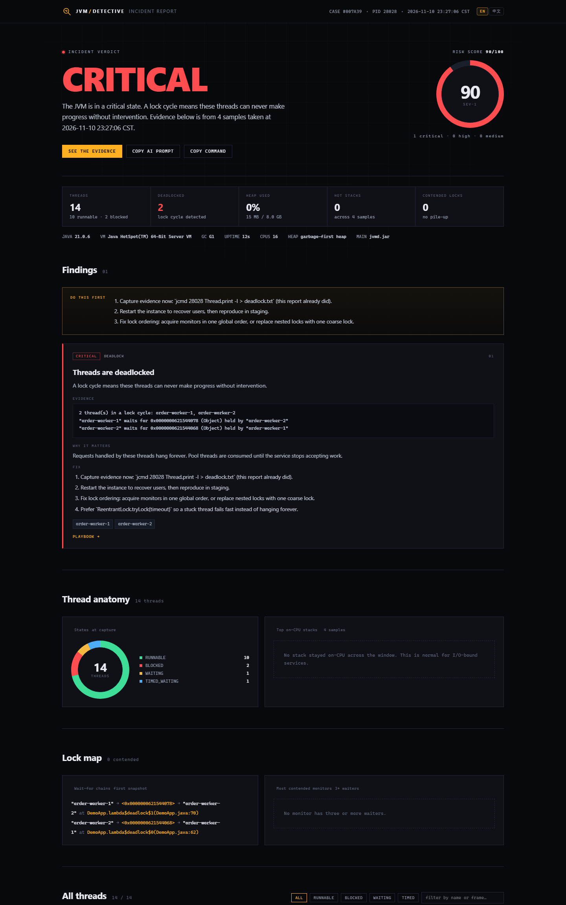

# JVM Detective

**One command to find out why your Java service is slow, stuck or dead — and one report you can hand to the next person.**

`jvmd` attaches to a running JVM with nothing but `jcmd`, samples thread dumps for a few seconds, and turns the evidence into a severity-ranked incident report. No agent. No server. No configuration. One jar.

[](https://adoptium.net/)
[](LICENSE)
[](https://modelcontextprotocol.io)
[](https://github.com/carefreebit/jvm-detective/releases)



The HTML report ships with a one-click **EN / 中文** switch: UI copy, findings and the AI handoff prompt are translated, while proper nouns such as `JVM`, `deadlock`, `heap`, `jcmd`, `RUNNABLE` and `CRITICAL` stay in English. Your choice is remembered in `localStorage`.

[中文报告预览](docs/img/report-zh.png)

---

## The 2 a.m. problem

A service is down. You have three tools:

- `jstack` gives you 4,000 lines of threads and no opinion.
- Arthas gives you a shell — powerful, but you still have to know what to type.
- A profiler gives you a flame graph of the last 30 seconds, but not a verdict.

What you actually need at 2 a.m. is an answer: **is it CPU, a lock, a thread leak, or a downstream dependency?** And then something you can paste into the incident channel.

JVM Detective is built around that moment. It samples, cross-checks the samples, ranks what it finds by severity, and writes a report that states the verdict in the first line.

```bash
jvmd list                      # which JVMs can I see?
jvmd investigate 12345         # sample for ~3s, write a report
```

```
  JVM DETECTIVE  v1.0.0   case F61FE7
  ------------------------------------------------------------------------
  target    order-service.jar  (pid 12345)
  runtime   21.0.6  |  G1  |  up 3d 4h  |  16 cpus
  threads   212 total  |  11 runnable  |  2 blocked  |  198 waiting  |  2 deadlocked
  heap      3.9 GB / 8.0 GB  (48%)

  VERDICT   CRITICAL   [CRITICAL]
  The JVM is in a critical state. A lock cycle means these threads can never make
  progress without intervention.

  [ CRITICAL ] Threads are deadlocked
           2 thread(s) in a lock cycle: order-worker-1, order-worker-2
           fix: Capture evidence now: `jcmd 12345 Thread.print -l > deadlock.txt`
  ...
  report    .../jvmd-reports/case-f61fe7-20261110-225041/report.html
```

Exit code is `0` (healthy), `1` (degraded) or `2` (critical), so it drops straight into a health check or CI gate.

---

## Install

Requires JDK 17+ on the machine that runs `jvmd`. The **target** JVM can be any modern JDK — nothing is installed into it.

```bash
# Build from source (one minute)
git clone https://github.com/carefreebit/jvm-detective.git
cd jvm-detective
mvn -q -DskipTests package
java -jar target/jvmd.jar --help

# Optional: put it on your PATH
alias jvmd='java -jar /opt/jvmd.jar'
```

A prebuilt jar is attached to every [release](https://github.com/carefreebit/jvm-detective/releases).

---

## What it finds

| Finding | Signal it keys on | Default severity |
|---|---|---|
| **Deadlock** | explicit `Found one Java-level deadlock`, or a wait-for cycle across `waiting to lock` / `locked` | CRITICAL |
| **CPU hotspot** | the same non-idle RUNNABLE stack in ≥60% of samples; a single snapshot needs ≥2 threads on it | CRITICAL / HIGH |
| **Thread leak** | total threads ≥400, one thread group ≥150, or ≥40 new threads across the sampling window | HIGH |
| **Lock pile-up** | ≥3 threads queued on one monitor whose owner is known | HIGH / MEDIUM |
| **Connection-pool starvation** | many threads parked inside `getConnection` / HikariCP | HIGH |
| **Downstream stall** | many threads in `Future.get`, HTTP client, Redis or JDBC reads | MEDIUM |
| **Heap / Metaspace pressure** | `GC.heap_info` usage ≥75%, Metaspace committed/reserved ≥95% | HIGH / MEDIUM |

Every finding carries **evidence** (the exact lock ids, owner threads and stacks), **why it matters**, and a **fix** written for the person on call. When nothing is wrong you get a `HEALTHY` verdict instead of a wall of noise.

### Sampling beats snapshots

A single thread dump cannot tell a busy loop from a one-off burst, or a deadlock from a slow lock. `jvmd` takes 6 samples over ~3 seconds by default and only escalates what persists. That is the difference between "this stack appeared once" and "this stack is the incident".

```bash
jvmd investigate 12345 --samples 10 --interval-ms 300
```

---

## The report

Each run writes a folder, never touching the target process:

```
jvmd-reports/case-f61fe7-20261110-225041/
├── report.html      # self-contained, no CDN, opens offline, printable
├── report.md        # paste into Slack / Jira / GitHub
├── report.json      # stable schema for dashboards and CI
└── thread-dump.txt  # the raw evidence, untouched
```

The HTML report includes:

- a verdict and a **0–100 risk score** with severity band;
- the thread-state donut and top on-CPU stacks;
- a lock map of wait-for chains and most-contended monitors;
- every finding with evidence, impact, fixes and a link to a playbook;
- a filterable list of every thread;
- **Copy AI prompt** — a self-contained Markdown brief you can paste into any LLM;
- **Copy command** — the exact `jcmd` line that reproduces the capture.

It is one file. Email it, attach it to a ticket, archive it next to the incident.

---

## Use it from an AI agent (MCP)

`jvmd mcp` is a Model Context Protocol server over stdio. Claude Desktop, Cursor, Cline and friends can inspect a JVM the same way you do.

```json
{
  "mcpServers": {
    "jvm-detective": {
      "command": "java",
      "args": ["-jar", "/opt/jvmd.jar", "mcp"]
    }
  }
}
```

Tools exposed:

| Tool | What the model gets |
|---|---|
| `jvm_list_processes` | attachable JVMs with pid, main class and command line |
| `jvm_investigate` | samples a pid and returns a ranked Markdown incident report (plus the HTML path) |
| `jvm_analyze_thread_dump` | analyses a dump pasted as text — for locked-down prod or a container you cannot enter |

The server never sends data anywhere. The model decides what to do with the text you give it.

---

## Reproduce an incident on purpose

Six real failure modes, generated inside the tool's own JVM, so you can see the detector work before you trust it in production:

```bash
jvmd demo deadlock
jvmd demo cpu-spin
jvmd demo thread-leak
jvmd demo lock-contention
jvmd demo pool-starvation
jvmd demo downstream-block
```

Each demo starts the offending threads, investigates its own process, prints the verdict and writes a full report. The test suite replays real captures of the same shapes, so the rules are verified without starting any threads.

---

## How it works

```
jcmd ──► Collector ──► parsers ──► Analyzer ──► reports
         (VM facts,     (threads,    (rules,      (HTML/MD/JSON)
          GC, heap,      locks,       sampling
          N × dumps)     states)      correlation)
```

1. **Collect** — `VM.system_properties`, `VM.flags`, `VM.uptime`, `GC.heap_info`, then N × `Thread.print -l`, all through the JDK's own `jcmd` binary.
2. **Parse** — thread headers (including the optional `[tid]` field), states, stack frames, `waiting to lock` / `locked` / `parking` relations, deadlock sections, heap lines.
3. **Analyze** — rule engine with sampling thresholds; findings are deduplicated so one root cause does not appear as three alarms.
4. **Report** — one scoring model shared by HTML, Markdown and JSON, so the verdict never disagrees across formats.

No bytecode instrumentation, no `-javaagent`, no attach API, no JMX port. If `jcmd` can attach, `jvmd` works.

---

## Safety

- **Read-only.** The only operation sent to the target is `jcmd <pid> Thread.print` and read-only VM queries.
- **No data leaves the machine.** No telemetry, no upload, no account.
- **No dependencies in the target.** Nothing is installed, no agent is loaded, no restart required.
- **Bounded cost.** Sampling stops after `--samples`; `jcmd` calls time out after 25s; the report caps the thread table at 1,200 rows.

Caveat worth knowing: taking a thread dump pauses the target briefly (typically single-digit milliseconds). On a JVM with thousands of threads and a very tight latency budget, lower `--samples` or use `jvmd analyze` on a dump captured by your existing tooling.

---

## CI and health checks

```bash
jvmd investigate "$PID" --samples 6 --quiet --print json > report.json
echo $?   # 0 healthy, 1 degraded, 2 critical
```

The JSON schema is stable: `verdict`, `riskScore`, `findings[]` (id, severity, category, evidence, fixes), `hotspots[]`, `contentions[]`, `stats`, `target`. Gate a deploy on `riskScore < 45`, or fail a canary when a deadlock appears.

---

## Documentation

- [Triage: the first five minutes](docs/playbooks/triage.md)
- [Deadlock](docs/playbooks/deadlock.md) · [CPU spin](docs/playbooks/cpu-spin.md) · [Lock contention](docs/playbooks/lock-contention.md)
- [Thread leak](docs/playbooks/thread-leak.md) · [Pool starvation](docs/playbooks/pool-starvation.md)
- [Downstream stall](docs/playbooks/downstream-stall.md) · [Memory pressure](docs/playbooks/memory-pressure.md)

中文文档：[README.zh-CN.md](README.zh-CN.md)

---

## Limitations

- It is a **triage tool, not a profiler**. For allocation hotspots, use JFR or async-profiler; for object graphs, take a heap dump.
- Rules are heuristics. A `HIGH` means "this is worth two minutes of your attention", not "this is definitely the root cause".
- The target must be reachable by the same user's `jcmd` (same UID, or root). Containers need `jcmd` inside the container or a shared PID namespace.
- Windows, Linux and macOS are supported. The report is identical everywhere; only the attach mechanics differ.

## Roadmap

- [ ] JFR correlation for allocation and GC pauses
- [ ] `--watch` mode with a rolling baseline
- [ ] Kubernetes helper: resolve pod → pid and copy the report out
- [ ] Pluggable rule packs

Ideas and false-positive reports are welcome — open an issue with the `jvmd` version and the JSON report (redact hostnames).

## Contributing

```bash
mvn test        # parser, analyzer, report and risk-score tests
mvn package     # produces target/jvmd.jar
```

Please keep the rules explainable: every finding needs evidence, an impact sentence, and a fix that a tired engineer can execute.

## License

Apache-2.0. See [LICENSE](LICENSE).
