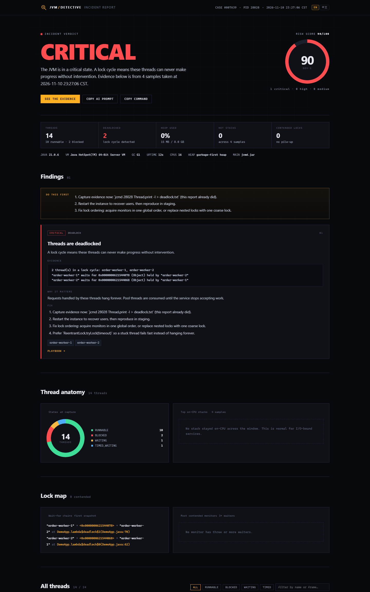

# JVM Detective

**一条命令，查清 Java 服务为什么变慢、卡死或挂掉；一份报告，直接交给下一个接手的人。**

`jvmd` 不需要 agent、不需要起服务、不需要改配置，只借用 JDK 自带的 `jcmd` 连上正在运行的 JVM，连续采样几秒线程栈，然后输出一份按严重程度排序的故障报告。一个 jar，开箱即用。

[](https://adoptium.net/)
[](LICENSE)
[](https://modelcontextprotocol.io)
[](https://github.com/carefreebit/jvm-detective/releases)



报告支持一键 **EN / 中文** 切换：界面文案、findings 和 AI 提示词都会切换，而 `JVM`、`deadlock`、`heap`、`jcmd`、`RUNNABLE`、`CRITICAL` 这类专有词汇保留英文。语言选择会记在 `localStorage` 里。

[中文报告预览](docs/img/report-zh.png)

---

## 凌晨两点的困境

线上服务挂了，你手上有三样东西：

- `jstack` 给你四千行线程栈，但不会告诉你结论；
- Arthas 给你一个命令行，能力很强，但你得先知道该敲什么；
- Profiler 给你一张火焰图，但不给你判决。

这个时刻真正需要的是一个答案：**到底是 CPU、锁、线程泄漏，还是下游依赖？** 然后是一份能直接贴进事故群的东西。

JVM Detective 就是为这个时刻做的：采样、交叉验证、按严重程度排序，报告第一行就是结论。

```bash
jvmd list                      # 本机有哪些 JVM 可以连？
jvmd investigate 12345         # 采样约 3 秒，生成报告
```

```
  JVM DETECTIVE  v1.0.0   case F61FE7
  ------------------------------------------------------------------------
  target    order-service.jar  (pid 12345)
  runtime   21.0.6  |  G1  |  up 3d 4h  |  16 cpus
  threads   212 total  |  11 runnable  |  2 blocked  |  198 waiting  |  2 deadlocked
  heap      3.9 GB / 8.0 GB  (48%)

  VERDICT   CRITICAL   [CRITICAL]
  The JVM is in a critical state. A lock cycle means these threads can never make
  progress without intervention.

  [ CRITICAL ] Threads are deadlocked
           2 thread(s) in a lock cycle: order-worker-1, order-worker-2
           fix: Capture evidence now: `jcmd 12345 Thread.print -l > deadlock.txt`
  ...
  report    .../jvmd-reports/case-f61fe7-20261110-225041/report.html
```

退出码 `0`（健康）、`1`（降级）、`2`（严重），可以直接塞进健康检查或 CI 卡点。

---

## 安装

运行 `jvmd` 的机器需要 JDK 17+；**被诊断的 JVM** 可以是任意现代 JDK，不需要装任何东西。

```bash
# 从源码构建（一分钟）
git clone https://github.com/carefreebit/jvm-detective.git
cd jvm-detective
mvn -q -DskipTests package
java -jar target/jvmd.jar --help

# 可选：放进 PATH
alias jvmd='java -jar /opt/jvmd.jar'
```

每个 [Release](https://github.com/carefreebit/jvm-detective/releases) 都会附带编译好的 jar。

---

## 能查出什么

| 问题 | 判定依据 | 默认级别 |
|---|---|---|
| **死锁** | `Found one Java-level deadlock`，或 `waiting to lock` / `locked` 构成等待环 | CRITICAL |
| **CPU 热点** | 同一段非空闲 RUNNABLE 栈出现在 ≥60% 的采样中；单次快照则要求 ≥2 个线程同栈 | CRITICAL / HIGH |
| **线程泄漏** | 线程总数 ≥400、单一线程组 ≥150，或采样窗口内新增 ≥40 个线程 | HIGH |
| **锁竞争** | 同一个 monitor 上 ≥3 个等待者，且能定位持有者 | HIGH / MEDIUM |
| **连接池耗尽** | 大量线程停在 `getConnection` / HikariCP 内部 | HIGH |
| **下游阻塞** | 大量线程停在 `Future.get`、HTTP 客户端、Redis 或 JDBC 读 | MEDIUM |
| **堆 / Metaspace 压力** | `GC.heap_info` 使用率 ≥75%，或 Metaspace committed/reserved ≥95% | HIGH / MEDIUM |

每条结论都带 **证据**（具体的锁 id、持有者线程、栈帧）、**影响**，以及一句值班的人能立刻执行的 **修复建议**。什么都没查出来时，给的是 `HEALTHY`，而不是一堆噪音。

### 采样，而不是一张快照

单次线程 dump 分不清「死循环」和「偶发尖峰」，也分不清「死锁」和「锁有点慢」。`jvmd` 默认在约 3 秒内采 6 次，只把持续存在的问题升级为告警。这就是「这段栈出现过一次」和「这段栈就是事故本身」的区别。

```bash
jvmd investigate 12345 --samples 10 --interval-ms 300
```

---

## 报告长什么样

每次运行只写一个新的目录，全程不碰目标进程：

```
jvmd-reports/case-f61fe7-20261110-225041/
├── report.html      # 单文件、无 CDN、离线可开、可直接打印
├── report.md        # 贴 Slack / Jira / GitHub
├── report.json      # 稳定 schema，供看板和 CI 使用
└── thread-dump.txt  # 原始证据，原样保留
```

HTML 报告包含：

- 结论，以及 **0–100 风险分**与严重等级；
- 线程状态环形图、占用 CPU 最多的栈；
- 等待链与竞争最激烈的 monitor；
- 每条发现的证据、影响、修复建议和对应排查手册；
- 可筛选的全部线程列表；
- **Copy AI prompt**：一段自包含的 Markdown 简报，直接粘给任意大模型；
- **Copy command**：复现这次采集的精确 `jcmd` 命令。

它就是一个文件。发邮件、挂工单、和事故记录一起归档都行。

---

## 让 AI Agent 直接用（MCP）

`jvmd mcp` 是一个基于 stdio 的 Model Context Protocol 服务。Claude Desktop、Cursor、Cline 等客户端可以像你一样检查 JVM。

```json
{
  "mcpServers": {
    "jvm-detective": {
      "command": "java",
      "args": ["-jar", "/opt/jvmd.jar", "mcp"]
    }
  }
}
```

暴露的工具：

| 工具 | 模型能拿到什么 |
|---|---|
| `jvm_list_processes` | 可连接的 JVM：pid、主类、命令行 |
| `jvm_investigate` | 采样指定 pid，返回按严重程度排序的 Markdown 报告（附 HTML 路径） |
| `jvm_analyze_thread_dump` | 分析以文本传入的线程 dump —— 适合无法 attach 的生产环境或容器 |

服务本身不向外发送任何数据，返回的文本由你和你选择的模型决定怎么用。

---

## 故意制造一场事故

内置六种真实故障模式，跑在工具自己的 JVM 里。先看它怎么工作，再决定要不要信它：

```bash
jvmd demo deadlock
jvmd demo cpu-spin
jvmd demo thread-leak
jvmd demo lock-contention
jvmd demo pool-starvation
jvmd demo downstream-block
```

每个 demo 会启动对应的问题线程、诊断自己的进程、打印结论并生成完整报告。这些场景同时也是测试用例的 fixture。

---

## 工作原理

```
jcmd ──► Collector ──► parsers ──► Analyzer ──► reports
         (VM 信息、     (线程、      (规则、      (HTML/MD/JSON)
          GC、堆、       锁、        采样关联)
          N 次 dump)     状态)
```

1. **采集**：`VM.system_properties`、`VM.flags`、`VM.uptime`、`GC.heap_info`，然后 N 次 `Thread.print -l`，全部通过 JDK 自带的 `jcmd`。
2. **解析**：线程头（含可选的 `[tid]` 字段）、状态、栈帧、`waiting to lock` / `locked` / `parking` 关系、死锁段、堆信息。
3. **分析**：带采样阈值的规则引擎；同一条根因只报一次，避免一个锁引发三条告警。
4. **报告**：HTML、Markdown、JSON 共用同一套评分模型，三种格式的结论不会互相矛盾。

没有字节码增强，没有 `-javaagent`，不依赖 attach API，也不需要开 JMX 端口。`jcmd` 能连上，`jvmd` 就能用。

---

## 安全性

- **只读**：发给目标进程的只有 `jcmd <pid> Thread.print` 和只读的 VM 查询。
- **数据不出机器**：没有埋点、没有上传、不需要账号。
- **不给目标装东西**：不加载 agent，不改配置，不重启。
- **开销可控**：采满 `--samples` 就停；单次 `jcmd` 25 秒超时；报告最多渲染 1,200 行线程。

需要知道的代价：抓线程 dump 会让目标 JVM 短暂停顿（通常是个位数毫秒）。线程数极多、延迟预算极紧的 JVM，可以调小 `--samples`，或用 `jvmd analyze` 分析现成的 dump。

---

## CI 与健康检查

```bash
jvmd investigate "$PID" --samples 6 --quiet --print json > report.json
echo $?   # 0 健康，1 降级，2 严重
```

JSON schema 稳定：`verdict`、`riskScore`、`findings[]`（id、severity、category、evidence、fixes）、`hotspots[]`、`contentions[]`、`stats`、`target`。可以用 `riskScore < 45` 卡发布，也可以在金丝雀环境里一出现死锁就失败。

---

## 文档

- [排查总纲：最初的五分钟](docs/playbooks/triage.md)
- [死锁](docs/playbooks/deadlock.md) · [CPU 空转](docs/playbooks/cpu-spin.md) · [锁竞争](docs/playbooks/lock-contention.md)
- [线程泄漏](docs/playbooks/thread-leak.md) · [连接池耗尽](docs/playbooks/pool-starvation.md)
- [下游阻塞](docs/playbooks/downstream-stall.md) · [内存压力](docs/playbooks/memory-pressure.md)

English: [README.md](README.md)

---

## 局限

- 它是 **分诊工具，不是 profiler**。要看分配热点，用 JFR 或 async-profiler；要看对象引用图，抓 heap dump。
- 规则是启发式的。`HIGH` 的意思是「值得花两分钟看一眼」，不是「这一定就是根因」。
- 目标进程必须能被同一个用户的 `jcmd` 连上（同 UID 或 root）。容器场景需要容器内有 `jcmd`，或共享 PID namespace。
- 支持 Windows、Linux、macOS。报告完全一致，只有 attach 的细节不同。

## 路线图

- [ ] 关联 JFR，补充分配和 GC 停顿证据
- [ ] `--watch` 模式与滚动基线
- [ ] Kubernetes 辅助：pod → pid，并把报告取出来
- [ ] 可插拔规则包

欢迎提想法和误报 —— 开 issue 时附上 `jvmd` 版本和 JSON 报告（记得脱敏主机名）。

## 参与贡献

```bash
mvn test        # 解析、分析、报告与风险分测试
mvn package     # 生成 target/jvmd.jar
```

请保持规则可解释：每条发现都要有证据、一句影响、一条疲惫的工程师也能执行的修复建议。

## 许可证

Apache-2.0，见 [LICENSE](LICENSE)。
